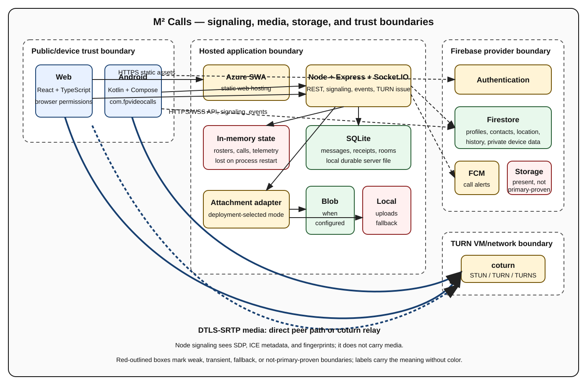

# M² Calls architecture

- **Source baseline:** repository commit
  `e74e890d5777db112ea8cedfb4d0d932169b3254`, reviewed 2026-11-06
- **Purpose:** system architecture and runtime reference
- **Scope:** implemented source behavior and explicit unknowns, not an
  aspirational redesign

Private-socket authentication, socket-bound room controls, and trusted invitation
identity are deployed on Azure at the source revision above. Deployed telemetry
compatibility is preserved. Live user acceptance testing is complete for the
features checked; self-pin/primary behavior was not manually checked.

The editable source is
[system-overview.mmd](docs/assets/architecture/system-overview.mmd). A complete
text equivalent follows so color and graphics are not required.

## Text equivalent

Browser and Android clients obtain identity from Firebase Authentication for
authenticated application flows. They call the Node/Express API over HTTPS and
connect to Socket.IO over WSS. The server verifies Firebase ID tokens for
authenticated REST chat routes. Guest rooms and TURN issuance support
account-free access; private Socket.IO identity requires a verified Firebase ID
token, and room controls are bound to the current roster socket. Remaining call
ownership gaps are described in [SECURITY.md](SECURITY.md).

The Node service relays SDP offers, SDP answers, ICE candidates, call events,
typing events, and opted-in telemetry. Audio/video never passes through the
signaling API. Each client creates peer connections; media uses DTLS-SRTP
directly between clients when a host/srflx pair succeeds or through coturn when
a relay pair is selected. Coturn receives time-limited HMAC credentials from
`GET /api/turn`, which currently accepts caller-provided identifiers without
application authentication.

Durable application data is split between Firestore and server-local SQLite.
Attachments use Azure Blob Storage when configured and otherwise use a local
uploads directory. Firebase Storage rules/configuration also exist, but the
reviewed server upload route selects Blob/local storage and Firebase Storage is
not established as the primary current upload path. Active room rosters,
primary-speaker choice, call signaling, telemetry subscriptions, and rate state
are in memory. FCM carries incoming-call/cancel/answer notification metadata to
Android devices.

## Component map

| Component | Responsibility | State and boundary | Source |
|---|---|---|---|
| React/TypeScript web | Authenticated shell, guest rooms, calling, chat, location views, diagnostics | Browser trust boundary; public runtime config | [web/src](web/src) |
| Kotlin/Compose Android | Calling, FCM/full-screen ringing, chat, contacts, location collection/history, diagnostics | Device permissions and local persistence | [mobile app source](mobile-kotlin/app/src/main) |
| Node/Express/Socket.IO | REST chat/call API, room signaling, telemetry relay, TURN credential issuance | Mixed authenticated and guest boundaries | [server/index.js](server/index.js) |
| SQLite | Conversations, messages, receipts, members, room settings, previews | Durable local server file; backup behavior unknown | [server/chat-db.js](server/chat-db.js) |
| Firebase Auth/Firestore/FCM | Identity, profiles/contacts/history/location, private device data, notifications | Provider-managed; rules vary by collection | [firestore.rules](firestore.rules) |
| Blob/local attachment adapter | Upload, download, delete, SAS/local URL selection | Deployment-selected at server startup | [server/blob-storage.js](server/blob-storage.js) |
| coturn | STUN/TURN allocations and relayed media | Separate VM/network/security boundary | [server TURN contract](server/turn-config.js) |
| Azure SWA/App Service | Web hosting and Node hosting | Deployed application revision is recorded above; broader live configuration remains unverified | [deployment guide](docs/azure-deploy.md) |

**Trade-off:** one Node process plus SQLite and in-memory state keeps the
personal-use deployment manageable, but it couples scaling/failover to process
and local disk behavior.

**Limitation:** direct client access to Firebase and mixed server persistence mean
this is not a system-wide Clean Architecture implementation.

## WebRTC signaling, media, and TURN

1. A participant joins a room through Socket.IO.
2. The server records the participant in an in-memory roster and sends the
   current participant list.
3. Clients create one peer connection per remote participant and exchange SDP
   and ICE through server events.
4. ICE selects a direct candidate pair when possible.
5. If direct traversal fails and TURN is usable, media is relayed by coturn.
6. Media remains DTLS-SRTP protected between peer connections, including when
   packets traverse TURN. Signaling infrastructure still processes SDP, ICE
   metadata, and DTLS fingerprints.

Recovery code uses selected ports/adapters:
[web peer recovery](web/src/services/peerRecovery.ts),
[Android recovery coordinator](mobile-kotlin/app/src/main/java/com/fpvideocalls/webrtc/IceRecoveryCoordinator.kt),
and [TURN lease manager](mobile-kotlin/app/src/main/java/com/fpvideocalls/webrtc/TurnLeaseManager.kt).
The implemented sequence can refresh TURN credentials, request ICE restart,
replace a peer, and enter a terminal state.

**Trade-off:** mesh calling avoids an SFU dependency and preserves peer-to-peer
media where possible, but uplink use grows with each peer.

**Limitation:** open reconnect/bitrate issues
[#8](https://github.com/guiess/fp-video-calls/issues/8),
[#13](https://github.com/guiess/fp-video-calls/issues/13), and
[#14](https://github.com/guiess/fp-video-calls/issues/14) preclude reliability or
capacity guarantees.

## Identity, storage, and privacy boundaries

| Boundary | Authentication/authorization observed | Data visible |
|---|---|---|
| Authenticated REST chat | Firebase ID token middleware | Conversation/message/file metadata and SQLite-backed results |
| Socket.IO `chat_auth` | Required Firebase ID token; private UID derived solely from verified token; fails closed when Admin is unavailable | User-room events and typing/call delivery |
| Guest rooms/signaling | Optional room password; controls and sender identity bound to the current roster socket | Roster, SDP, ICE, transient room chat |
| TURN issuance | Bounded caller-supplied `userId`/`roomId`; no application token | Time-limited TURN username/credential/URLs |
| Firestore | Collection-specific rules | Profiles, contacts, histories, location, private subcollections |
| Attachment route | Authenticated upload API; local download route has no auth | Files and bearer/SAS URLs depending on storage mode |

Data inventory and retention evidence are maintained in
[SECURITY.md](SECURITY.md). Deployed Firestore rules restrict current location
and history reads to the signed-in owner or selected recipients, with owner-only
writes and deletes. The private recipient settings and tracking lifecycle are
described below. Storage rules allow broad authenticated
reads under chat paths. The server upload adapter uses Blob or filesystem
storage; Blob downloads use expiring bearer links, while filesystem links do
not expire. These storage modes have different access-control requirements.
Guest TURN issuance supports account-free calls and requires separate abuse
controls.

**Trade-off:** Firebase reduces identity/device-notification implementation cost,
while direct client access and server APIs create multiple authorization models
that must be reasoned about separately.

**Limitation:** current source does not establish a uniform capability model for
rooms, files, location, invitations, or TURN.

## Runtime flows and architectural trade-offs

### Guest room lifecycle

`POST /room` creates a human-readable ID and can persist an optional bcrypt
password hash. `join_room` loads or creates the room, checks the password,
updates the roster, and begins signaling. `leave_room`, disconnect, or explicit
close removes participants; an empty room is removed from memory and its room
row is deleted. Controls use the socket currently recorded for a participant:
any joined member may close the room, leave as themselves, pin themselves
(replacing another primary), and clear only their own pin. Relays require a
joined sender and a current target in the same room; transient chat uses the
roster's sender identity and display name. Replacement sockets evict the previous
socket from the room channel and telemetry subscriptions while preserving
mic/camera state. Guest IDs remain account-free reconnect identifiers, not
persistent authenticated identities or host capabilities. `[OWASP]` `[CUSTOM]`

Room group channels are internally prefixed with `room:` to isolate them from
private `user:` and automatic Socket.IO socket-ID channels; wire room IDs stay
unchanged. Room IDs accept 1-128 characters without control characters and
reject the reserved `user:` and `room:` prefixes; ordinary custom names remain valid.
Participant IDs are bounded to 128 characters without control characters.
Display names are bounded to 200 characters and passwords to 1024 characters.
`POST /room/:roomId/close` always rejects with HTTP 403
`ROOM_SOCKET_REQUIRED`; both web close buttons use the joined signaling socket
and await a bounded acknowledgement instead. Existing mobile socket-close
clients continue to receive `ROOM_CLOSED` without requiring an acknowledgement.

### Authenticated invitation lifecycle

An authenticated REST request supplies callee/room fields. The server binds the
invitation caller UID to the verified Firebase ID token and resolves name/photo
through Firebase Auth, ignoring legacy body identity fields. Missing profile
fields use `User`/no photo; a failed profile lookup returns HTTP 500
`CALLER_PROFILE_LOOKUP_FAILED` before any socket or FCM delivery. The same
`call_invite` identity and call UUID reach user Socket.IO rooms and FCM. Android
can display full-screen ringing and enter the room. Cancel/answer ownership
checks remain a separate limitation.

### Persistent and transient chat

Authenticated REST routes persist conversations, messages, receipts, members,
and file metadata in SQLite. Socket.IO emits typing/message events. In-room
`chat_message` is a separate bounded transient broadcast and is not persisted as
the durable conversation model. Blob storage is selected when its connection
string exists; local files are the fallback.

### Location lifecycle

Android requests fine/coarse/background location, runs a foreground service,
writes current/history documents, and may resume configured behavior after boot.
Clients read and merge history for display. Cleanup is client-triggered; no
server-enforced physical retention deadline is configured.

Location reads require the signed-in owner or an exact UID match in
`locationSharing.sharedWith` from `users/{ownerUid}/private/userData`, not the
public profile. Missing or malformed settings deny nonowner access; the owner
retains access. Writes and deletes remain owner-only. The rules read this
document internally without granting recipients access to private account/device
fields. Both clients use owner-scoped current-document listeners and
history queries ordered by `timestamp`.
Android's tracking toggle remains local-only: stopping updates retains selected
recipients' access to stored current location and history.
Removing a recipient stops future authorized server reads, not access to
previously downloaded or cached copies. `[OWASP]`

### Telemetry lifecycle

Telemetry is off unless a participant opts in. Joined room members subscribe and
publish validated bounded samples; the server derives sender identity from room
membership and does not persist relay samples. Android may retain bounded local
telemetry. Prohibited fields are defined by
[server telemetry validation](server/telemetry-validation.js) and
[Android recovery policy](mobile-kotlin/app/src/main/java/com/fpvideocalls/webrtc/RecoveryTelemetryPolicy.kt).

The source preserves deployed v1 metric envelopes and v2 opaque diagnostic
text, including Unicode/LF, with 2048 text-code-unit and 4096 payload-byte limits.
[The relay](server/telemetry-relay.js) requires publisher consent and current
sender/recipient roster, socket, and internal `room:` channel membership.
Unsupported versions have a distinct error. Twenty samples per ten seconds
are tracked per socket/room across unsubscribe, leave, close and rejoin;
disconnect clears the counter and consent. Replacement sockets never inherit
consent. These compatibility checks are deployed and do
not alter private auth, guest control authority, or Firebase rules. `[OWASP]`

**Trade-off:** specialized code around recovery and storage uses useful
interfaces/adapters, but introducing a repository-wide abstraction rewrite would
expand scope without improving the current personal-use architecture.

**Limitation:** state ownership is mixed across clients, Firebase, SQLite, Blob,
local disk, and memory.

## Tests, recovery, and known defects

| Area | Present | Current gaps |
|---|---|---|
| Firestore emulator | Location owner/recipient boundary, private settings isolation, malformed settings, revocation | Device/cross-client behavior beyond the emulator |
| Web unit tests | Config, encryption format/display, location, recovery, telemetry | Browser E2E and current cross-device interop |
| Server tests | Storage, image processing, previews, quotas, TURN, telemetry | Complete authorization and live dependency integration |
| Android unit tests | Calls, chat models, location, notifications, recovery, TURN lease, telemetry | Device/UI suite and cross-device integration |
| Documentation tests | Required files, names, links, images, and manifests | Manual review remains part of documentation updates |

The canonical commands are in
[BUILD_INSTRUCTIONS.md](BUILD_INSTRUCTIONS.md). Documentation distinguishes
tests present, tests executed locally, and live observations.

**Trade-off:** unit-level recovery logic is deterministic and fast to validate,
but real WebRTC behavior depends on browsers, devices, networks, TURN, and
signaling timing.

## Deployment, provenance, and operations

The web is built for Azure Static Web Apps, the Node application for Azure App
Service/Oryx, and coturn for a separately managed VM. Runtime web signaling
configuration prefers `window.APP_CONFIG.SIGNALING_URL`; Vite values and
`config.js` are public and cannot hold secrets. Server secrets belong in runtime
settings. A source ZIP accepted by App Service is not a build-once artifact
because Oryx may restore/build after upload.

Artifact records and verification procedures are maintained in
[release documentation](docs/releases/README.md). Future binaries can use the
deferred `ci-built` manifest profile in
[release-manifest.schema.json](docs/releases/release-manifest.schema.json),
independent hashing, Android signature verification, test evidence, and separate
build/release attestation identities. No release-build automation is implemented
in this repository.

**Trade-off:** manual server/TURN operations keep the deployment simple, but
provide less repeatability than infrastructure as code.

**Limitation:** broader live resource configuration, rollback timing,
data recovery, monitoring, quotas, and cost alerts remain operator-verified or
unknown until recorded.

## Failure modes

| Failure | Expected effect | Evidence/response |
|---|---|---|
| Signaling unavailable | New joins/signaling/call events fail; established peer media may continue temporarily | Check WSS and App Service, not only `/health` |
| TURN unavailable | Direct pairs may work; restricted NAT paths fail | Force relay and record selected candidate pair plus bidirectional media |
| Firebase Auth/Firestore/FCM unavailable | Authenticated flows, client data, or push ringing degrade independently | Verify each dependency separately |
| SQLite/local disk unavailable | Persistent chat/history/file fallback fails | Restore known data separately from application rollback |
| Blob unavailable/misconfigured | Upload/download/SAS paths fail or fallback differs by restart configuration | Record active storage mode |
| Process restart | In-memory roster/call/telemetry state is lost | Clients reconnect; recovery is bounded, not seamless |
| Permission denied on device | Camera, microphone, notifications, Bluetooth, or location behavior is unavailable | Explain permission-specific fallback |

## Design decision summary

- Document actual mixed boundaries rather than claim system-wide Clean
  Architecture. `[CLEAN-ARCH]`
- Keep signaling separate from encrypted media transport. `[CUSTOM: WebRTC]`
- Preserve immutable artifact identity and source provenance. `[GOOGLE-ENG]`
- Depend on manifest contracts and validators rather than release prose.
  `[HEXAGONAL]`
- Keep documentation validation separate from trusted deployment authorization.
  `[OWASP]`
