# M² Calls

M² Calls is a personal-use communications app for web and Android. It supports
WebRTC audio/video calls, persistent messaging, contacts, files, call history,
and location sharing. The app is under active development and is intentionally
not production-ready.

> **Safety notice:** Private socket identity, call authorization, and file-access
> controls still need hardening. Do not use sensitive conversations or confidential files.
> Remaining authorization and privacy limitations are documented in
> [SECURITY.md](SECURITY.md).

## Availability

- **Web app:** [Open M² Calls](https://thankful-moss-0611ddf0f.3.azurestaticapps.net)
- **Android:** [Download version 1.0.0.191](https://github.com/guiess/fp-video-calls/releases/download/mobile-v1.0.0.191/M2Calls-1.0.0.191-debug.apk)
  for Android 8.0 or later. See the [release notes](https://github.com/guiess/fp-video-calls/releases/tag/mobile-v1.0.0.191)
  or [build from source](BUILD_INSTRUCTIONS.md).
- **Server status:** [`/health`](https://app-voice-video-server.azurewebsites.net/health)
  reports process liveness only.

## Screenshots

Personal information is redacted in the screenshots.

### Guest web

| Guest entry | Create or join a guest room |
|---|---|
| 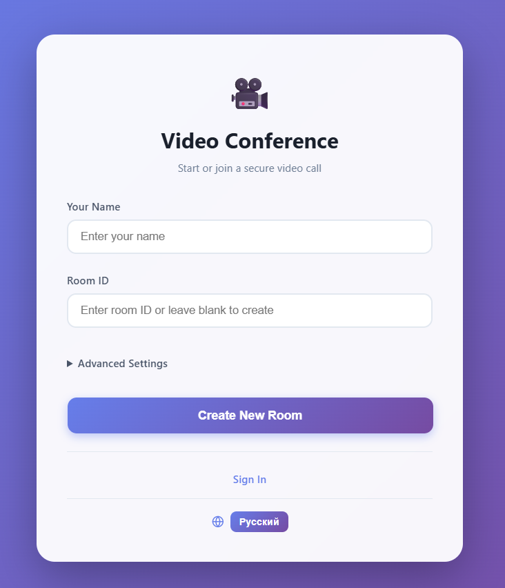 | 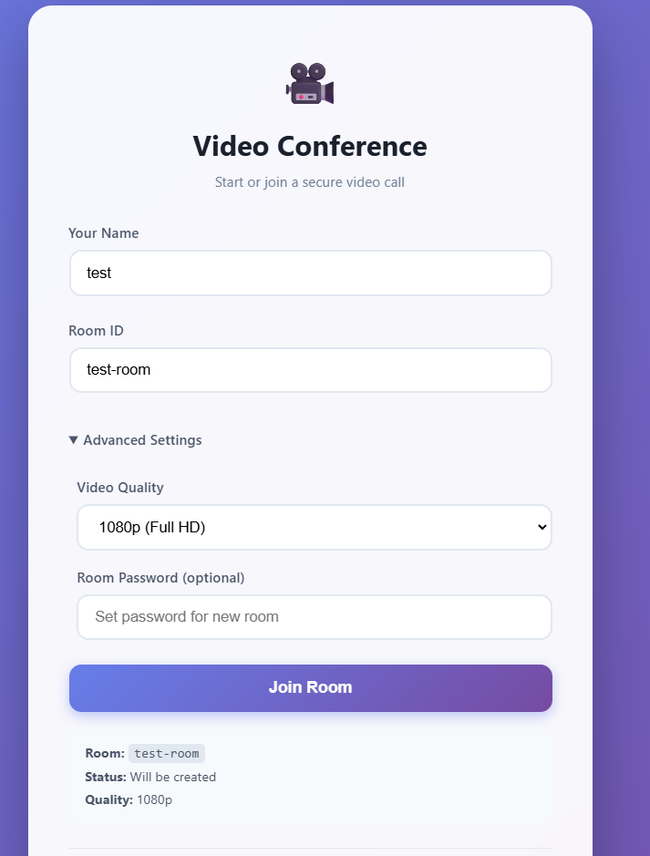 |

**Guest group call**

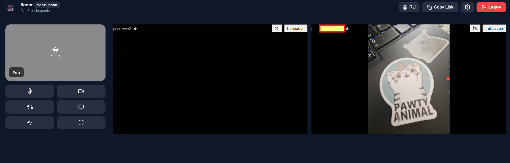

### Authenticated web

| Chats | Rooms |
|---|---|
| 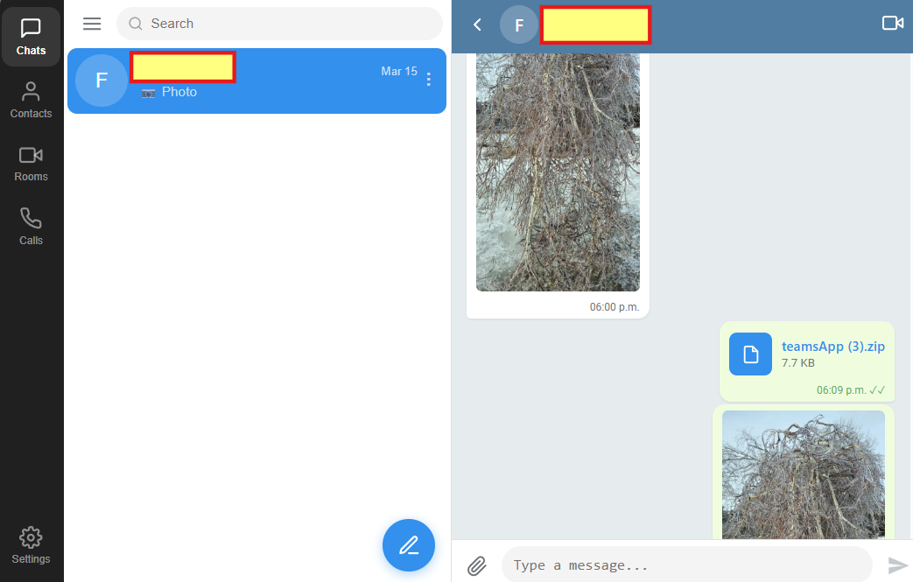 | 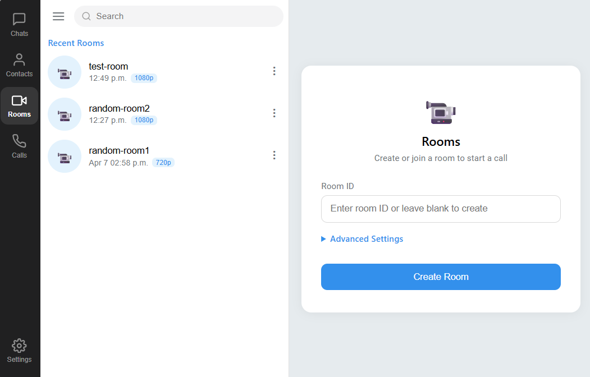 |

**Calls**

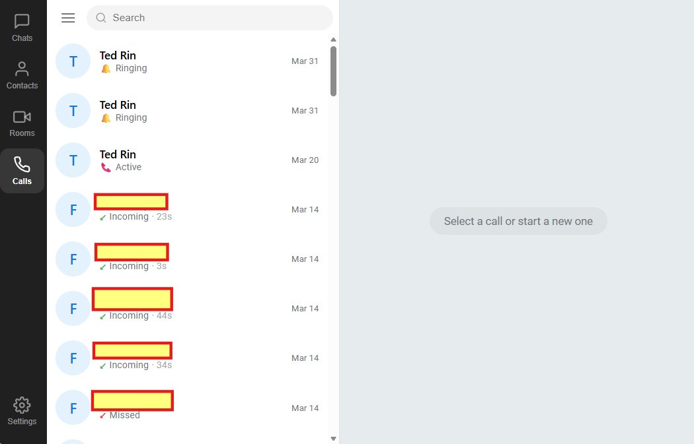

### Android app

| Chats | Conversation |
|---|---|
| 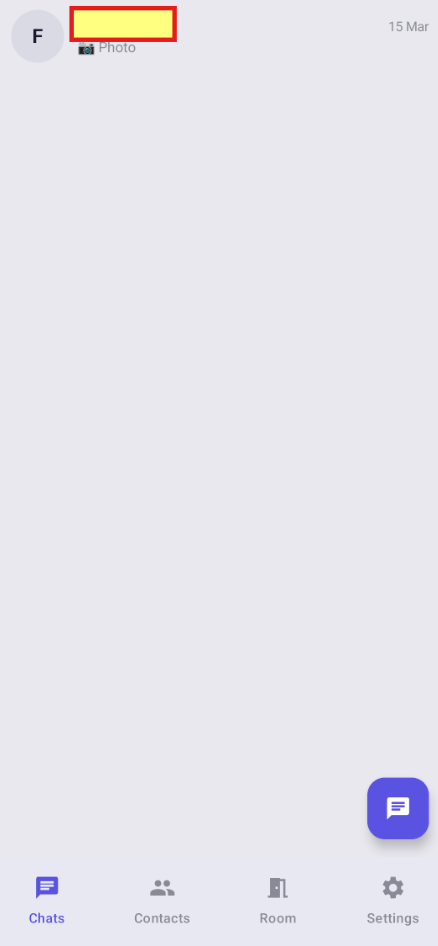 | 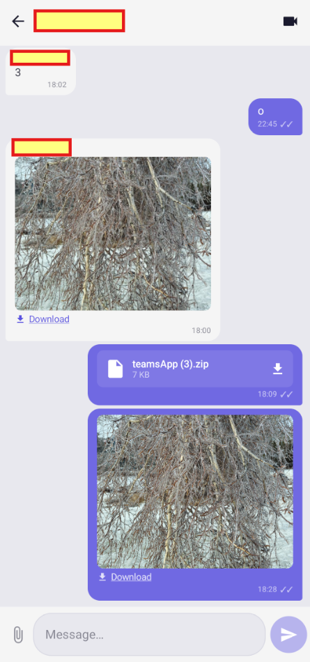 |

| Contacts | Rooms |
|---|---|
| 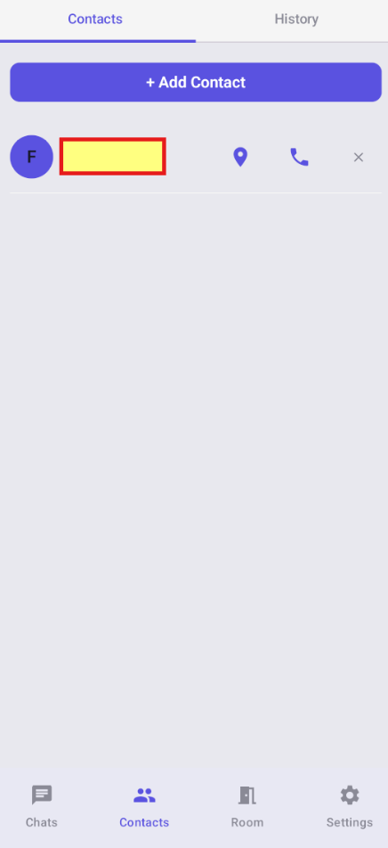 | 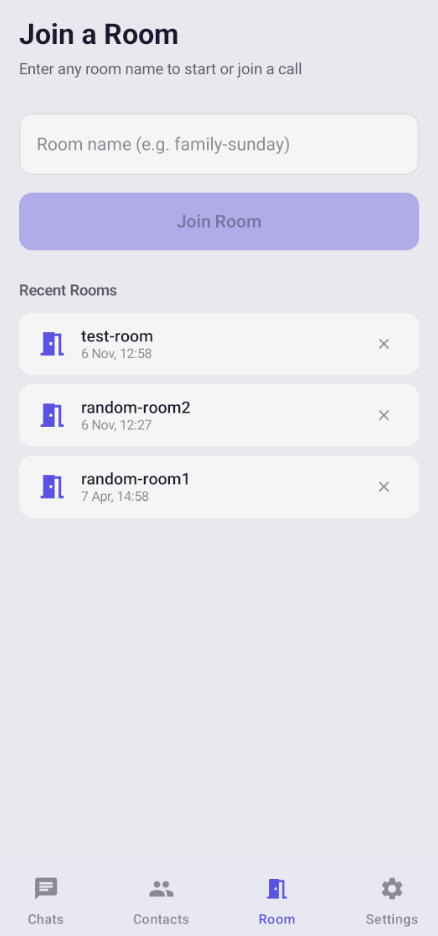 |

**Android group call**

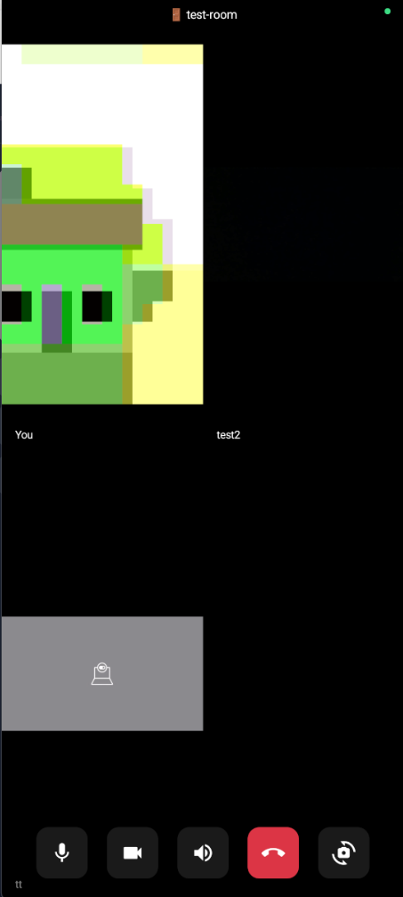

The guest web and Android galleries include group calls with multiple
participants and the available call controls.

## WebRTC calls

M² Calls establishes browser and Android peer connections while the Node and
Socket.IO service relays SDP offers, SDP answers, and ICE candidates. Media
travels directly between peers when possible or through coturn when a relay
candidate pair is selected; signaling does not carry audio or video. The
implemented mesh is intended for small calls, but this repository provides no
current capacity or universal-connectivity guarantee.

Implementation:
[web peer orchestration](web/src/services/webrtc.ts),
[Android peer orchestration](mobile-kotlin/app/src/main/java/com/fpvideocalls/webrtc/WebRTCManager.kt),
[server signaling relay](server/index.js), and
[architecture flow](ARCHITECTURE.md).

## Direct and group calling

Authenticated call flows support direct/group invitations, web socket delivery,
FCM delivery to Android, ringing, answer/cancel, room entry, and call history.
Guest rooms provide persistent-looking room identifiers and optional passwords,
with account-free access. Room controls use the currently joined socket, not a
claimed acting user ID. Any joined member can close the room for everyone;
members can pin themselves and clear only their own pin. See
[SECURITY.md](SECURITY.md) for remaining limitations.

Implementation:
[web call service](web/src/services/callService.ts),
[Android call API](mobile-kotlin/app/src/main/java/com/fpvideocalls/data/CallApiService.kt),
[Android FCM receiver](mobile-kotlin/app/src/main/java/com/fpvideocalls/service/FcmService.kt),
and [server call routes](server/index.js).

## Location sharing

Android can collect current and historical location, run a foreground location
service, restore configured behavior after boot, and publish data to Firestore.
Web and Android can view current location and history, readable only by the
signed-in owner or selected recipients. Recipients must exactly match a UID in
`locationSharing.sharedWith` in `users/{ownerUid}/private/userData`; missing or
malformed settings deny nonowner access. Writes remain owner-only.
Stopping tracking stops new updates but selected recipients retain access to
stored current/history data. Removing a recipient stops future authorized server
reads, not access to downloaded or cached copies.
See [Security and privacy](SECURITY.md#location-authorization) for details.

Implementation:
[location service](mobile-kotlin/app/src/main/java/com/fpvideocalls/service/LocationTrackingService.kt),
[web location view](web/src/screens/LocationPanel.tsx), and
[reviewed Firestore rules](firestore.rules).

## Persistent communication and supporting capabilities

- Persistent direct/group chat, replies, deletion, read receipts, typing
  indicators, membership management, image/file sharing, and search are backed
  by the authenticated REST API plus SQLite.
- Transient in-room chat is a separate Socket.IO room event and is not the same
  durable conversation model.
- Contacts, groups, room history, and call history are stored through Firestore
  or local/client models depending on the path.
- English and Russian UI resources exist across the clients.
- Recovery code covers bounded ICE restart, peer replacement, TURN lease
  refresh, and terminal failure states. Open issues
  [#8](https://github.com/guiess/fp-video-calls/issues/8),
  [#13](https://github.com/guiess/fp-video-calls/issues/13),
  [#14](https://github.com/guiess/fp-video-calls/issues/14), and
  [#17](https://github.com/guiess/fp-video-calls/issues/17) prevent a claim that
  reconnect, bitrate, delay, or telemetry behavior is fully solved.
- Opt-in call telemetry is validated and relayed to subscribed room members;
  Android also has bounded local persistence. It is not a hosted monitoring
  service.

## Technical architecture

- WebRTC signaling/media separation with direct and TURN-relayed media paths.
- Cross-platform React/TypeScript and Kotlin/Compose clients.
- Firebase Auth/Firestore/FCM integration and a Node/Socket.IO application
  boundary.
- SQLite persistence with Azure Blob Storage or local-filesystem attachment
  adapters.
- Ephemeral coturn HMAC credentials and client-side refresh/recovery logic.
- Unit suites for web services, server storage/TURN/telemetry behavior, and
  Android domain/recovery logic.
- Release metadata and documentation checks.

## Architecture, security, and operations

- [Architecture reference](ARCHITECTURE.md)
- [Security, privacy, permissions, and reporting](SECURITY.md)
- [Build and test from a clean checkout](BUILD_INSTRUCTIONS.md)
- [Canonical Azure deployment guide](docs/azure-deploy.md)
- [Release evidence and withdrawal procedure](docs/releases/README.md)
- [System diagram](docs/assets/architecture/system-overview.svg) and [editable source](docs/assets/architecture/system-overview.mmd)
- [Build and verification records](docs/validation-status.md)

## Current limitations

- The live deployment revision, Azure SKU, active Blob/local storage mode,
  coturn listener/firewall agreement, retention configuration, and monitoring
  configuration are not established by repository evidence.
- Current active web and Android text-send paths use reversible Base64 encoding
  with empty encrypted-key maps. Base64 encoding is not end-to-end encryption;
  cryptographic helpers exist but are not the universal active send path.
- Known access-control gaps include token-optional private Socket.IO identity,
  unchecked room controls, and call identity/ownership checks.
  Attachment access depends on the storage
  mode. Account-free guest calling, temporary download links, and guest TURN
  credentials are design choices, with access and abuse controls described in
  [SECURITY.md](SECURITY.md).
- The signaling service uses in-memory active call/roster/telemetry state and a
  local SQLite database, which complicates horizontal scaling and seamless
  failover.
- No production SLA, RPO/RTO, penetration-test result, privacy certification,
  or measured participant-capacity promise is provided.
- `server-deploy.zip` is historical tracked material and is not accepted as a
  current deployment package.

Warnings document risk; they do not remediate runtime defects. See
[SECURITY.md](SECURITY.md) for the complete boundary inventory.

## Build, test, and deployment

Follow [BUILD_INSTRUCTIONS.md](BUILD_INSTRUCTIONS.md). Common developer
commands are:

```bash
node --test scripts/tests/*.test.mjs
cd web && npm ci && npm test && npm run build
cd ../server && npm ci && node node_modules/vitest/vitest.mjs run
npm run test:turn && npm run test:telemetry
cd ../mobile-kotlin && bash ./gradlew test assembleDebug
```

Deployment and operational guidance is maintained in
[docs/azure-deploy.md](docs/azure-deploy.md).

## Ownership and maintenance

I primarily owned product direction and architecture. AI tools assisted implementation, tests, and documentation under my direction and review.

This repository is owner-maintained; external contributions are not accepted.
Pull requests are not accepted. See [SECURITY.md](SECURITY.md) for how to arrange
a confidential security report.

The owner-authored repository material is licensed under
[Apache License 2.0](LICENSE), subject to the rights and exclusions described in
[THIRD_PARTY_NOTICES.md](THIRD_PARTY_NOTICES.md).

## Legacy identifiers

M² Calls is the canonical public product name. `fp-video-calls` remains the
legacy repository identifier, `com.fpvideocalls` remains the Android application
ID/package, and `M2Calls` remains a build/output identifier. These names trace
one project; they are not separate current products.
