# M² Calls

M² Calls is an experimental full-stack WebRTC portfolio project for browser and
Android calling, communication, and location-sharing workflows. It demonstrates
product architecture across React/TypeScript, Kotlin/Compose, Node/Socket.IO,
Firebase, SQLite, Azure storage, and coturn. It is an engineering case study,
not a production communications service.

> **Safety notice:** Do not use personal conversations, sensitive files, or real location data.
> Known authorization and privacy limitations are documented in
> [SECURITY.md](SECURITY.md).

## Evaluate the project

| Surface | Entry point | What it proves | Important limitation |
|---|---|---|---|
| Current live web deployment | [Open the M² Calls web demo](https://thankful-moss-0611ddf0f.3.azurestaticapps.net) | The public web entry point was reachable during the 2026-11 documentation review | Reachability does not prove dependency health, call interoperability, data authorization, monitoring, or a specific deployed source revision |
| Server liveness | [Open `/health`](https://app-voice-video-server.azurewebsites.net/health) | The Node process can answer its liveness route | `/health` is not a readiness, dependency, security, or media-relay check |
| Historical Android binary | [View the `mobile-v1.0` release](https://github.com/guiess/fp-video-calls/releases/tag/mobile-v1.0) | A preserved Android debug artifact exists under its historical identity | See the mandatory warning below and the [release receipt](docs/releases/mobile-v1.0-receipt.json) |

> **Historical, non-production M2 Video Calls Android debug build.** This APK
> predates the canonical M² Calls portfolio package and is associated with
> `mobile-v1.0`, whose tag diverges from current main. Its original build source
> and build process have not been verified. Use only on a test device with
> synthetic, non-sensitive data. Compatibility with the current live services
> is not established.

## Product evidence

The privacy-redacted images below are UI evidence, not proof that every
dependency or cross-platform scenario completed successfully. Web captures are
app-viewport-only images from the live `/app` surface; the deployed source
revision is unknown. Android captures come from the exact historical
`mobile-v1.0` debug APK and are not represented as current-main output. Capture
hashes, review results, and limitations are recorded in
[the asset provenance register](docs/assets/README.md).

| Surface | Web | Historical Android APK |
|---|---|---|
| Chats list | 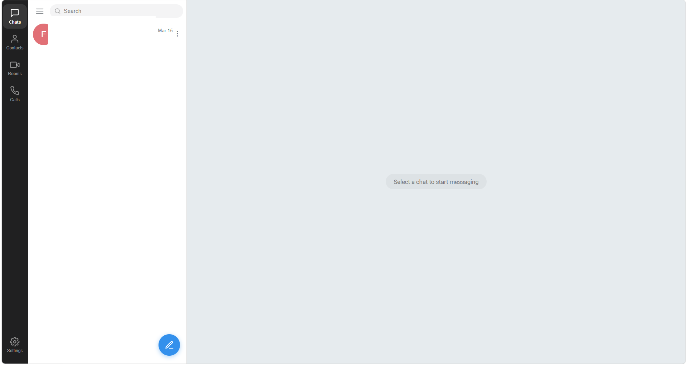 | 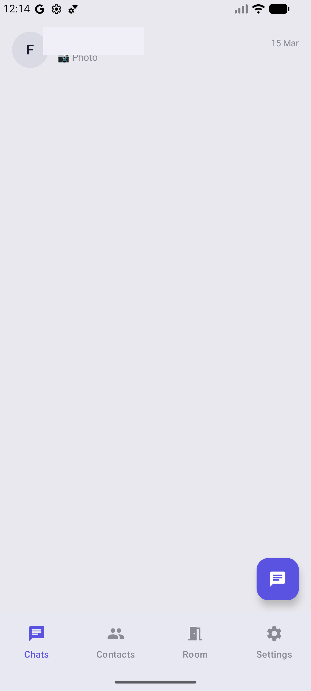 |
| Conversation | 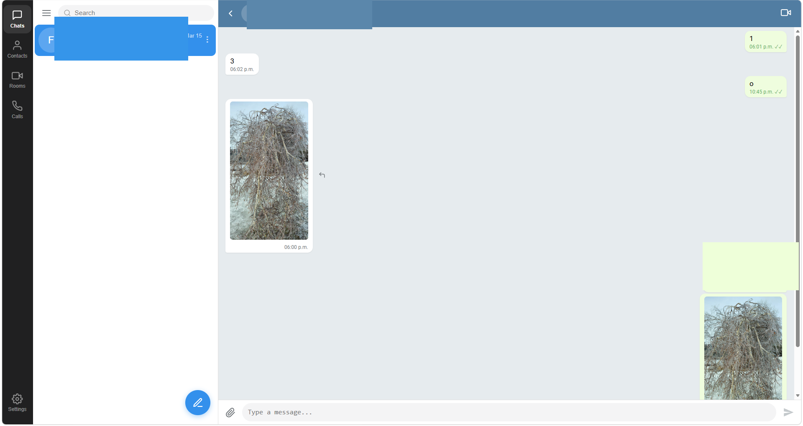 | 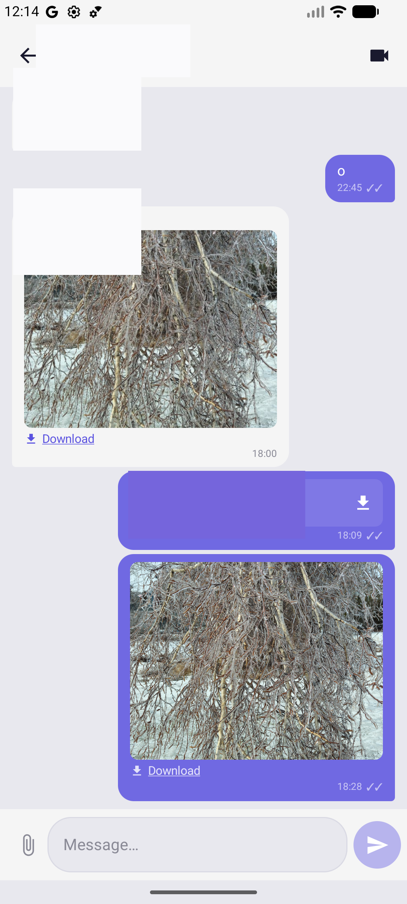 |
| Contacts | 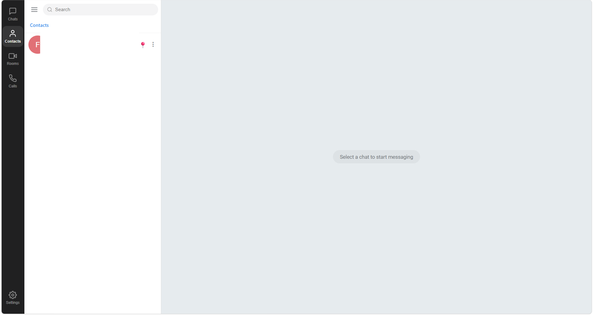 | 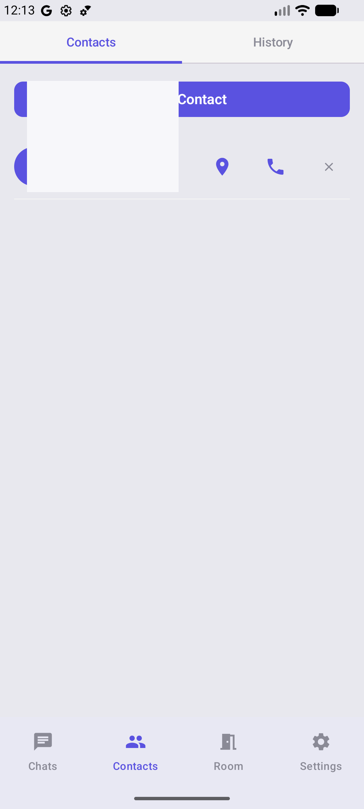 |
| Room page | 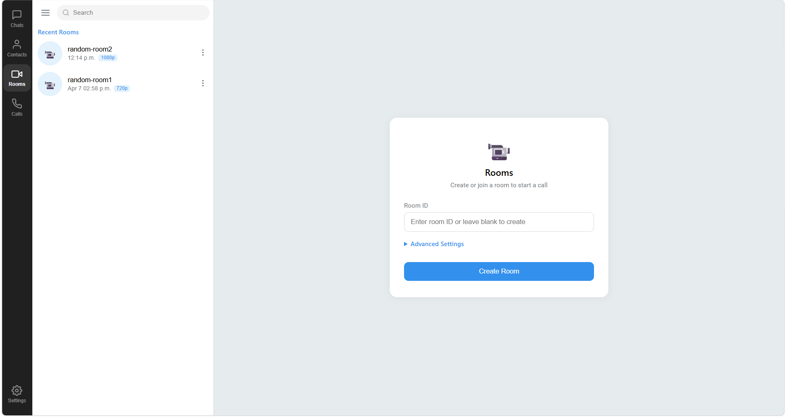 | 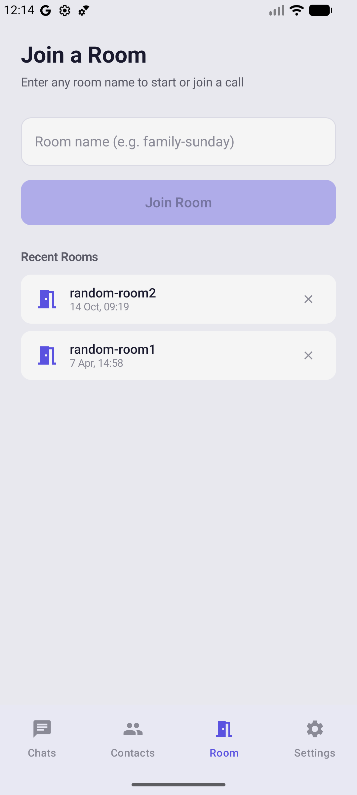 |
| Joined room | 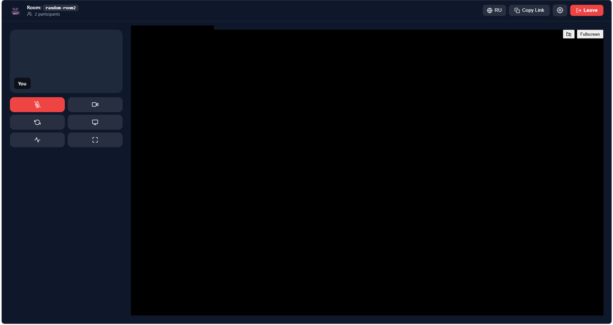 | 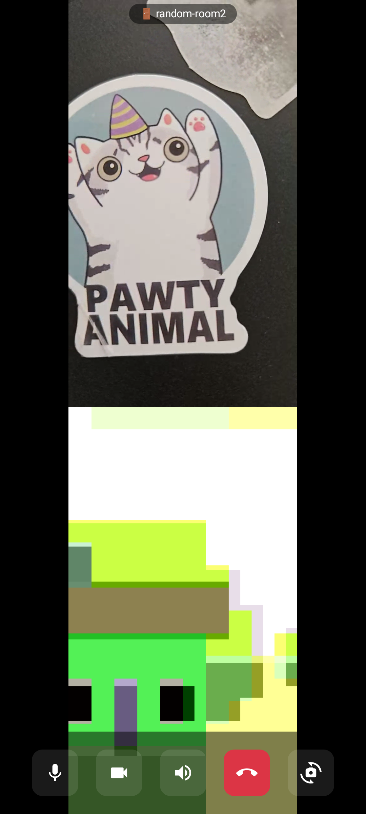 |
| Contact location | Web capture intentionally skipped | 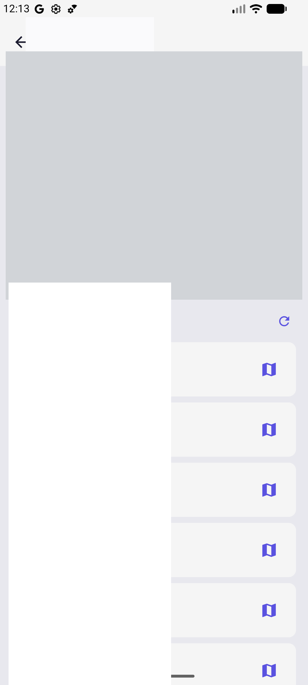 |

The joined-room captures demonstrate that each UI displayed two participants.
They do not establish media interoperability, authorization correctness,
capacity, reliability, or production readiness.

## WebRTC calls

M² Calls establishes browser and Android peer connections while the Node and
Socket.IO service relays SDP offers, SDP answers, and ICE candidates. Media
travels directly between peers when possible or through coturn when a relay
candidate pair is selected; signaling does not carry audio or video. The
implemented mesh is intended for small calls, but this repository provides no
current capacity or universal-connectivity guarantee.

Evidence:
[web peer orchestration](web/src/services/webrtc.ts),
[Android peer orchestration](mobile-kotlin/app/src/main/java/com/fpvideocalls/webrtc/WebRTCManager.kt),
[server signaling relay](server/index.js), and
[architecture flow](ARCHITECTURE.md).

## Direct and group calling

Authenticated call flows support direct/group invitations, web socket delivery,
FCM delivery to Android, ringing, answer/cancel, room entry, and call history.
Guest rooms provide persistent-looking room identifiers and optional passwords,
but their control and signaling authorization boundaries are intentionally
documented as limitations rather than presented as remediated.

Evidence:
[web call service](web/src/services/callService.ts),
[Android call API](mobile-kotlin/app/src/main/java/com/fpvideocalls/data/CallApiService.kt),
[Android FCM receiver](mobile-kotlin/app/src/main/java/com/fpvideocalls/service/FcmService.kt),
and [server call routes](server/index.js).

## Location sharing

Android can collect current and historical location, run a foreground location
service, restore configured behavior after boot, and publish data to Firestore.
Web and Android surfaces can view location history. Use simulated coordinates
only: reviewed Firestore rules allow any authenticated user to read stored
location current/history, and client cleanup does not establish a guaranteed
physical deletion deadline.

Evidence:
[location service](mobile-kotlin/app/src/main/java/com/fpvideocalls/service/LocationTrackingService.kt),
[web location view](web/src/screens/LocationPanel.tsx), and
[reviewed Firestore rules](firestore.rules).

## Persistent communication and supporting capabilities

- Persistent direct/group chat, replies, deletion, read receipts, typing
  indicators, membership management, image/file sharing, and search are backed
  by the authenticated REST API plus SQLite.
- Transient in-room chat is a separate Socket.IO room event and is not the same
  durable conversation model.
- Contacts, groups, room history, and call history are stored through Firestore
  or local/client models depending on the path.
- English and Russian UI resources exist across the clients.
- Recovery code covers bounded ICE restart, peer replacement, TURN lease
  refresh, and terminal failure states. Open issues
  [#8](https://github.com/guiess/fp-video-calls/issues/8),
  [#13](https://github.com/guiess/fp-video-calls/issues/13),
  [#14](https://github.com/guiess/fp-video-calls/issues/14), and
  [#17](https://github.com/guiess/fp-video-calls/issues/17) prevent a claim that
  reconnect, bitrate, delay, or telemetry behavior is fully solved.
- Opt-in call telemetry is validated and relayed to subscribed room members;
  Android also has bounded local persistence. It is not a hosted monitoring
  service.

## Engineering highlights

- WebRTC signaling/media separation with direct and TURN-relayed media paths.
- Cross-platform React/TypeScript and Kotlin/Compose clients.
- Firebase Auth/Firestore/FCM integration and a Node/Socket.IO application
  boundary.
- SQLite persistence with Azure Blob Storage or local-filesystem attachment
  adapters.
- Ephemeral coturn HMAC credentials and client-side refresh/recovery logic.
- Unit suites for web services, server storage/TURN/telemetry behavior, and
  Android domain/recovery logic.
- Release-provenance schema, historical artifact receipt, and local
  documentation/provenance checks.

## Architecture, security, and operations

- [Architecture and six-part interview guide](ARCHITECTURE.md)
- [Security, privacy, permissions, and reporting](SECURITY.md)
- [Build and test from a clean checkout](BUILD_INSTRUCTIONS.md)
- [Canonical Azure deployment guide](docs/azure-deploy.md)
- [Release evidence and withdrawal procedure](docs/releases/README.md)
- [Editable and rendered system diagram](docs/assets/README.md)
- [Executed validation and pending external evidence](docs/validation-status.md)

## Current limitations

- The live deployment revision, Azure SKU, active Blob/local storage mode,
  coturn listener/firewall agreement, retention configuration, and monitoring
  configuration are not established by repository evidence.
- Current active web and Android text-send paths use reversible Base64 encoding
  with empty encrypted-key maps. Base64 encoding is not end-to-end encryption;
  cryptographic helpers exist but are not the universal active send path.
- Reviewed authorization boundaries include token-optional Socket.IO chat
  identity, broad location/file reads, unauthenticated local-file downloads,
  caller-provided call identity fields, guest-room control gaps, and
  unauthenticated TURN issuance.
- The signaling service uses in-memory active call/roster/telemetry state and a
  local SQLite database, which complicates horizontal scaling and seamless
  failover.
- No production SLA, RPO/RTO, penetration-test result, privacy certification,
  or measured participant-capacity promise is provided.
- `server-deploy.zip` is historical tracked material and is not accepted as a
  current deployment package.

Warnings document risk; they do not remediate runtime defects. See
[SECURITY.md](SECURITY.md) for the complete boundary inventory.

## Build, test, and deployment

Follow [BUILD_INSTRUCTIONS.md](BUILD_INSTRUCTIONS.md). The canonical validation
commands are:

```bash
node --test scripts/tests/*.test.mjs
cd web && npm ci && npm test && npm run build
cd ../server && npm ci && node node_modules/vitest/vitest.mjs run
npm run test:turn && npm run test:telemetry
cd ../mobile-kotlin && ./gradlew test assembleDebug
```

Deployment behavior and unknown live facts are separated in
[docs/azure-deploy.md](docs/azure-deploy.md). Validation in this repository is
local/manual. Future validation automation is deferred.

## Ownership and maintenance

I primarily owned product direction and architecture. AI tools assisted implementation, tests, and documentation under my direction and review.

This repository is owner-maintained; external contributions are not accepted.
Pull requests are not accepted. Security reports remain welcome through the
private route in [SECURITY.md](SECURITY.md).

The owner-authored repository material is licensed under
[Apache License 2.0](LICENSE), subject to the rights and exclusions described in
[THIRD_PARTY_NOTICES.md](THIRD_PARTY_NOTICES.md).

## Legacy identifiers

M² Calls is the canonical public product name. `fp-video-calls` remains the
legacy repository identifier, `com.fpvideocalls` remains the Android application
ID/package, `M2Calls` remains a build/output identifier, and M2 Video Calls is
the historical branding attached to `mobile-v1.0`. These names trace one project;
they are not separate current products.
